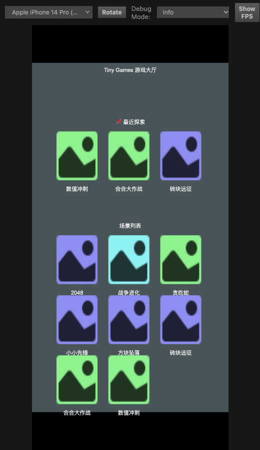
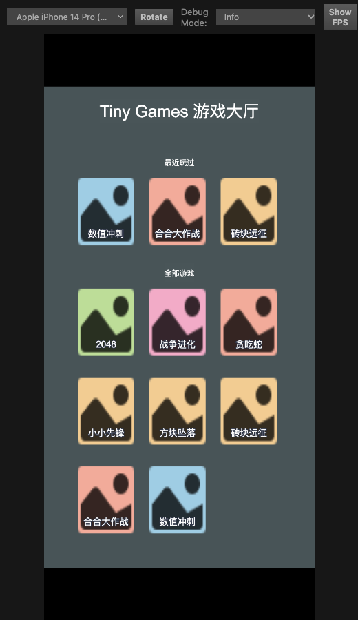

# 游戏大厅 — 滚动网格排版重做

> 日期：2026-11-01
> 反馈：「游戏大厅里的排版重叠了，而且也不太美观了，游戏多了之后，超出了，也不知道能不能往下滚动」
> 代码：`assets/main/scripts/{Lobby,GameGrid,GameIcon}.ts`、`assets/main/scenes/Lobby.scene`
> 相关：[`../specs/2026-05-12-phase1-lobby-design.md`](../specs/2026-05-12-phase1-lobby-design.md)（第一版大厅设计）

---

## 1. 三个现象 → 三个根因

| 现象 | 根因 | 修法 |
|------|------|------|
| 卡片上的游戏名压到下一行卡片的图标上 | 预制体里 `nameLabel` 在卡片本地 `y = -120.218`，而卡片只有 150×180（下边只到 −90），文字整个落在卡片外面 | `GameIcon.applyNameLabel()` 在运行时把文字收敛到 `LABEL_Y = -58`（卡片内底部），24 号字 + 深色描边 |
| 「最近游玩」和「全部游戏」两个分区叠在一起，卡片互相压 | 分区节点（`recentSection` / `allGamesSection`）和 `content` 的高度都停在编辑器里保存的旧值。`GameGrid.refresh()` 只刷新**自己这一格**的 Layout，外两层的 Layout 从不重算 | `Lobby.updateLayouts()` **由内向外**逐层 `layout.updateLayout()`：格子 → 分区 → content |
| 游戏从 6 款涨到 8 款后超出可视区，却滚不动、也没有任何提示 | content 高度没变（还是旧值），ScrollView 认为内容没有超出可视区 | content 用 `resizeMode = CONTAINER` 由 Layout 自动撑高；`scrollHint` 只在**内容真的高于可视区**时显示 |

> 关键一点：**光给 ScrollView 加 content 是不够的**。`cc.ScrollView` 只会在 `content` 的 `UITransform` 尺寸变化后才允许滚动，
> 而 `content` 的尺寸要由它自己的 `cc.Layout` 在子节点排完之后算出来 —— 所以刷新顺序是这套方案的全部难点。

---

## 2. 节点结构（MCP 实建）

场景 UUID `b87375b5-18ef-4a09-83a6-0bbdb086339b`，设计分辨率 720×1280：

```
Lobby (Scene)
└── Canvas                        720×1280
    ├── Camera
    ├── bg                        720×1280（纯色底）
    ├── ScrollView                720×1064，位置 (0, -44)
    │   └── view                  720×1064，挂 cc.Mask
    │       └── content           宽 720，锚点 (0.5, 1)，[Layout] → Lobby.content
    │           ├── recentSection      [Layout] → Lobby.recentSection
    │           │   ├── sectionTitle   Label「最近游玩」
    │           │   └── recentGrid      [Layout][GameGrid] → Lobby.recentGrid
    │           └── allGamesSection    [Layout]
    │               ├── sectionTitle   Label「全部游戏」
    │               └── allGamesGrid    [Layout][GameGrid] → Lobby.allGamesGrid
    ├── title                     424×66，位置 (0, 575)，「Tiny Games 游戏大厅」
    └── scrollHint                163×38，位置 (0, -610)，「下滑查看更多」→ Lobby.scrollHint
```

`title` 和 `scrollHint` 是 **Canvas 直接子节点**，不在 `content` 里 —— 标题固定不动，提示条固定在屏幕底部，
滚动时不会跟着卡片一起走。

---

## 3. 布局参数（逐层）

| 节点 | Layout 类型 | resizeMode | 参数 | 说明 |
|------|-------------|------------|------|------|
| `content` | VERTICAL | CONTAINER | `paddingTop 24`、`spacingY 48` | 高度 = 24 + 各分区高 + 48×间隔，由引擎自动算 |
| `recentSection` / `allGamesSection` | VERTICAL | CONTAINER | `spacingY 16` | 高度 = 标题 + 16 + 格子高 |
| `recentGrid` / `allGamesGrid` | GRID | CONTAINER | `cellSize 150×180`、`FIXED_COL 3`、`spacingX 40`、`spacingY 56` | 每行 3 张卡；3×150 + 2×40 = 530，两侧自然留白 |

ScrollView 只开纵向：`horizontal = false` / `vertical = true`（原本两个都是 true，斜着拖会横向漂移）。
`inertia`、`elastic`、`brake 0.5` 保持默认。

推导（8 款游戏 + 3 条最近记录）：

```
格子：3 行 × 180 + 2 × 56 = 652
分区：标题 50 + 16 + 652   = 718
最近：标题 50 + 16 + 180   = 246
content：24 + 246 + 48 + 718 = 1036 ≈ 1037   ← 实测 1037
```

`view` 高 1064，所以 8 款游戏时内容**刚好装得下**（1037 < 1064），不显示提示、也滚不动 —— 这是正确行为，不是坏了。
第 9 款游戏起 content 会超过 1064，提示条自动出现、ScrollView 同时变成可滚动。

---

## 4. 刷新顺序（由内向外）

```ts
// Lobby.refreshUI() 末尾
this.updateLayouts();

private updateLayouts(): void {
    this.applyLayout(this.recentSection);          // 1. 分区（内含格子）
    this.applyLayout(this.allGamesGrid.node.parent); // 2. 另一个分区
    this.applyLayout(this.content);                // 3. 外层
    this.updateScrollHint();                       // 4. 再判断要不要提示
}

private applyLayout(node: Node | null): void {
    if (!node || !node.isValid || !node.activeInHierarchy) return;
    const layout = node.getComponent(Layout);
    if (layout) layout.updateLayout();
}
```

三条约束：

1. **必须由内向外**。格子排完 → 分区才知道自己多高 → content 才按分区高度撑开。
   反过来，content 会按上一轮的分区高度撑开，卡片照样重叠（这就是旧版叠在一起的直接机制）。
2. **`activeInHierarchy` 要判**。「最近游玩」为空时 `recentSection.active = false`，未激活的节点 `updateLayout()` 不会重算，
   也不会影响 content —— 但如果不判，`getComponent(Layout)` 虽然拿得到，算出来的尺寸是上一轮的。
3. **`GameGrid.refresh()` 里那一次 `updateLayout()` 还留着**，它负责把新建的卡片摆进格子；`Lobby` 的三层刷新是它的外层补充。

---

## 5. 提示条判据

```ts
// Lobby.updateScrollHint()
const contentHeight = content.getComponent(UITransform).height;
const viewHeight = content.parent.getComponent(UITransform).height;  // view
hint.active = contentHeight > viewHeight + 1;   // +1 吃掉浮点误差
```

- content 的父节点就是 `view`，所以不需要额外 `@property`
- 只在**真的能滚**的时候提示；否则提示是假的（旧版的问题之一就是「看不出来能不能滚」）
- 同样的判据也可以写成 `Math.ceil`，这里用 `+1` 容差更直观

---

## 6. 卡片（GameIcon）：runtime 收敛 + 按 id 配色

美术资源仍然是零新增，靠色块 + 现有图标：

| 项 | 值 | 理由 |
|----|----|------|
| `LABEL_Y` | `-58` | 卡片高 180（上下各 ±90），文字落在卡片内下方，不会再压到下一行 |
| 字号 / 行高 | `24` / `26` | 三列布局下 150 宽能放下 5 个汉字 |
| 描边 | 2 px，`#2D3446` | 浅色卡片 + 深色描边，文字不会和图标糊在一起 |
| 底色 | 8 色浅色板，按 `id` 字符哈希取模 | 相邻卡片尽量不同色；用整串 id 求和，避免只按首字母取色导致大片同色 |

为什么要在运行时改一遍而不是改预制体：MCP 的 `prefab_update_prefab` 在本机**只改内存、不落盘**
（`GameIcon.prefab` 的 mtime 不变），所以场景重载后预制体数据依旧是旧的。
`applyNameLabel()` / `applyCardColor()` 在 `setup()` 里跑，保证不管预制体数据多旧，画面都是正确的。
（详见 [`../tech/mcp-scene-authoring-pitfalls.md`](../tech/mcp-scene-authoring-pitfalls.md)）

---

## 7. 视觉

- 浅色圆角卡片（粉 / 橙 / 绿 / 青 / 蓝 / 紫…）+ 深色图标剪影，与深蓝底 `#151E33` 高对比
- 三列等宽，行距 56 比卡片间距更 "松"，两段内容之间用 48 的间距 + 各分区标题做分隔
- 顶部 `title` 固定在屏幕上方，底部 `scrollHint` 固定在下方 —— 滚动时视觉锚点稳定
- 按下卡片有 `scale 0.95 → 1` 的回弹（`GameIcon.onTouchStart/End`），`TOUCH_CANCEL` 也会回弹，不会卡在缩小状态

**改前 / 改后**

| 改前 | 改后 |
|------|------|
|  |  |
| 文字在卡片外、压着下一行图标；末行被屏幕底边切掉；配色偏单调 | 文字收进卡片底部；分区之间有留白；末行完整可见；卡片按 id 八色区分 |

---

## 8. 浏览器验证记录（2026-11-01）

预览 `http://127.0.0.1:7456/?scene=b87375b5-18ef-4a09-83a6-0bbdb086339b`，canvas 393×850。控制台 0 error。

| 场景 | 操作 | 观测 |
|------|------|------|
| 默认（8 款 + 3 条最近） | 打开大厅 | content 高 **1037** < view **1064**，`scrollHint.active = false`；截图无重叠、三列齐整 |
| 模拟游戏变多 | 页内把 allGames 换成 15 项再 `updateLayouts()` | content **1509** > 1064，`scrollHint.active = true` |
| 真的能滚 | 在画布中央按下并上移 240 css px | `content.position.y 532 → 977`、`getScrollOffset().y 0 → 445`（= 1509 − 1064，正好到底） |
| ScrollView 方向 | 读组件属性 | `horizontal = false`、`vertical = true` |

> 注意：页内改 `allGames` 只影响当次运行，重载即恢复 8 款。

---

## 9. 后续

- 加第 9 款游戏时**不需要改任何布局代码**：content 自动变高、提示条自动出现。
- 若以后要「横向」分区（比如分类 tab），建议另开一个横向 ScrollView，不要复用这一个。
- `scrollHint` 目前是常驻提示字，可考虑改成「滚动时淡出、回顶时再出现」，避免长期占位。
