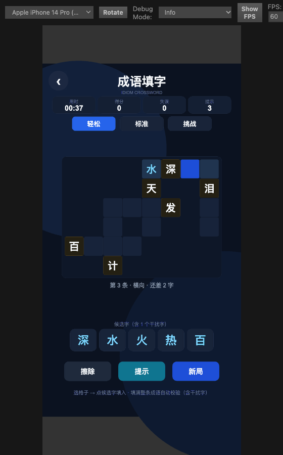

# 成语填字（`idiom`）玩法设计

- 日期：2026-11-05
- 状态：设计定稿，待实现
- 对应路线图：[`2026-11-05-game-catalog-and-roadmap.md`](../plans/2026-11-05-game-catalog-and-roadmap.md) §5.1（P0-1）
- 场景：`assets/games/game_idiom/scenes/Idiom.scene`
- id / sceneName：`idiom` / `Idiom`

---

## 1. 一句话玩法

纵横交错的成语盘上，每个空格用底部候选字填入；填满一条四字成语即自动校验，正确则锁定并计分，全部锁定通关。

## 2. 目标体验

- **单局 2–8 分钟**，随时可停、无死亡失败，只有「分数高低」。
- 核心乐趣来自三件事，按权重排列：
  1. **认字成词**：底部给出该条成语的四个字（外加干扰字），玩家需要从字组认出成语；
  2. **交叉约束**：两条成语共用一格，已锁定的字会反向提示相邻成语；
  3. **连击与时间**：连续一次填对不失误，得分加成；越快通关，时间奖励越高。
- 不追求「难」，追求「顺手、有反馈、想再来一局」。

## 3. 规则细则

### 3.1 棋盘

- 一局由 N 条四字成语组成（N 由难度决定），纵横交叉摆放成一整块棋盘，尺寸 8×8 / 10×10 / 13×13。
- 生成时保证：每条成语的每个字都在棋盘内；两条成语最多共享一格且字相同；不会出现两条平行成语首尾相接的「假词」。
- 每条成语至少预填 1 个已知字（简单难度强制；中/高难度按比例），已知字白色锁定。
- 棋子视觉：空格 / 已知字 / 选中格 / 当前成语高亮 / 已锁定（金色）。

### 3.2 候选字与填入

- 点击空格 → 选中该格，并激活它所属的成语（格子同时在横竖两条成语里时，再点一次同格切换方向）。
- 底部候选条显示**当前激活成语**的字符组：该成语的 4 个字（重复字按出现次数显示）+ 1/2/3 个干扰字（由难度决定）。
- 干扰字优先从**本局其他成语的字**里取（看起来合理，不会一眼排除），不足时从全局字频池补齐。
- 点候选字 → 填入当前选中格；可再点其它字覆盖；「擦除」清空当前格。
- **填完一个字后光标自动前移**到当前成语里下一个空格（按成语方向，绕过已锁定/已填的格）；整条填满则停在原地。
- **「擦除」会回退**：当前格有自己填的字就先清当前格；当前格是空的（因为自动前移了）就回退清除本成语里光标前一个自己填的字，并把光标移回去。连续点「擦除」可从后往前一格一格退干净。
- 候选字可重复使用（不做消耗），避免交叉格的状态同步问题。
- 交叉格：同一格同时属于横竖两条成语，填一次即同时生效。

### 3.3 校验与锁定

- 一条成语的四格**全部有字**且尚未锁定时立即校验：
  - **正确**：该条成语锁定，四格变金色、不可再改；连击 +1，加分。
  - **错误**：该条成语红闪 0.9 秒，然后清空其中**未锁定**的格子（已知字、提示字、别的已锁定成语的共用格保留）；失误 +1，连击归零。
- 一条成语被别的成语「顺带填对」时同样锁定（交叉格共享）。
- **锁定后自动取消选中**：当前成语完成即 `activeSlot = -1`、`selected = -1`，状态条回到「点一个格子开始填字」，避免玩家在已完成（金色）的格子上继续点候选字。
- 全部成语锁定 → 通关结算。

### 3.4 提示

- 选中空格后点「提示」：在**当前激活成语**里随机挑一个尚未填对、未锁定的格子，直接填入正确字并锁定。
- 每次提示扣 50 分；提示次数用尽后按钮置灰。
- 未选中任何可提示的成语时给出 toast，不消耗次数。
- **提示补满最后空格但这条成语里有玩家填错的字**：清掉这条成语里玩家填的字（已知字、提示字保留），光标回到第一个空格，toast「这条成语里有填错的字，已清空重填」。不这样做会卡死在「还差 0 字」——没有空格可填，也就永远不会触发校验（实测复现过，`core.hintClearedSlot` 标记 + `verify-idiom-core.js` 有回归用例）。

### 3.5 计分

| 项目 | 分值 |
|------|------|
| 完成一条成语 | +100 |
| 连击加成 | +20 × 当前连击数（单条最多 +100） |
| 失误一次 | -30 |
| 使用一次提示 | -50 |
| 通关时间奖励 | `max(0, 600 - 用时秒数 × 2)` |
| 难度系数 | 轻松 ×1.0 / 标准 ×1.3 / 挑战 ×1.6 |

- 局内实时显示「成语分 - 失误扣分 - 提示扣分」，最低为 0。
- 通关时：`最终分 = max(0, round((实时分 + 时间奖励) × 难度系数))`。
- 每个难度分别保存最高分（`localStorage`），结算面板提示「新纪录」。

### 3.6 难度

| 难度 | 成语数 | 棋盘 | 干扰字 | 已知字 | 提示次数 | 预估单局 |
|------|--------|------|--------|--------|----------|----------|
| 轻松 | 6 | 8×8 | 1 | 每条 1 个 | 3 | 2–3 min |
| 标准 | 9 | 10×10 | 2 | 约 2/3 的成语各 1 个 | 2 | 4–6 min |
| 挑战 | 12 | 13×13 | 3 | 约 1/2 的成语各 1 个 | 1 | 6–9 min |

- 难度按钮切换后直接开新局；难度偏好持久化。
- 最高分按难度分开存。

### 3.7 结算与重开

- 结算面板：难度、用时、失误、提示、成语得分、时间奖励、最终分、最佳分、是否新纪录。
- 按钮：「再来一局」（同难度） / 「换个难度」（循环切换）。
- 顶栏与结算面板均可返回大厅。
- 对局中途退出会存快照，再次进入自动续玩；通关或点击「新局」后清除快照。

### 3.8 存档

- 键：`tiny_games_idiom_best_<difficulty>`、`tiny_games_idiom_diff`、`tiny_games_idiom_save`。
- 快照保存：难度、种子、已填字、锁定格、锁定成语、失误、提示数、用时、是否已开始计时。读档时用同一种子重建棋盘再回填进度。

## 4. 界面布局（设计分辨率 720×1280，左上原点）

| 区域 | 位置 / 尺寸 |
|------|-------------|
| 返回按钮 | 左上 (58, 62)，72×72 圆钮 |
| 标题「成语填字」 | (360, 64)，40px；副标题 `IDIOM CROSSWORD` (360, 100) |
| 状态条 | y=150，用时 / 得分 / 失误 / 提示 四块 156×62 |
| 难度切换 | y=214，三个 150×48 按钮 |
| 棋盘 | 顶部 y=258，可用竖直区间高 598；格边长 70 / 60 / 46，外框留 10 |
| 当前成语提示 | 棋盘下 26px，一行 21px 文案 |
| 候选字条 | y≈966，按钮高度 80，宽度按数量自适应（5–7 个） |
| 操作栏 | y≈1090，「擦除 / 提示 / 新局」三个 170×70 |
| 底部说明 | y≈1176，19px 灰字 |

- 单格字号 = 格边长 × 0.52；已锁定字金色 `#FBBF24`，用户填字天蓝 `#7DD3FC`，已知字白色。
- **棋盘外框按实际内容裁剪并居中**：生成器只保证「成语之间合法交叉」，不保证铺满 `size × size` 网格，所以不能按整张网格画框（否则成语会明显偏到一角）。取所有已用格的行列包围盒 → 外框 = 包围盒 + 10px 内边距 → 水平居中于 x=360、在 y=258 起的 598px 区间内竖直居中。格子的局部坐标也按包围盒左上角重算。
- 空格的填充色比外框底略亮（`#17233A` vs `#0E1728`），保证未填格在深色底上仍然可辨。
- 安全区：复用现有 `SafeAreaAdapter` 的约定，内容整体在 720×1280 内，不做额外偏移。

## 5. 交互流程

```
进入场景
  └─ onLoad：读难度/最高分 → 建 UI → 有快照则恢复，否则 newGame()
选中空格
  ├─ 格子属于 0 条成语：不响应
  ├─ 格子所在成语已锁定：仅高亮，不显示候选
  └─ 否则：高亮整条成语 + 显示候选字条
点候选字
  └─ 填入 → 检查所有「刚好填满且未锁定」的成语
        ├─ 正确：锁定 + 连击 + 计分 + 音效位（v1 无音频）
        └─ 错误：红闪 → 清空未锁定格 → 失误 +1
通关
  └─ 停表 → 结算 → 存最高分 → 删快照
```

## 6. 词库

- 位置：`assets/games/game_idiom/scripts/IdiomData.ts`，导出 `IDIOM_LIST: string[]`。
- 约 260 条常用四字成语，全部简体、无重复、无变体选择符。
- 选择标准：大众熟悉、字面常见、互相之间有足够的共用字（便于交叉生成）。
- **不内置释义**（v1）：释义需要人工校对，写错会误导玩家；候选字机制本身已经承担「提示认词」的作用。v1.1 可补 100 条常用成语的释义作为可选线索。
- 用 TS 常量而非 JSON：纯逻辑层可直接被 Node 自检脚本编译，不需要运行时异步加载 `JsonAsset`。

## 7. 生成算法

1. 按种子洗牌词库，取前 N 条。
2. 第 1 条横放在棋盘中心。
3. 依次为后续成语寻找落点：随机选一条已放成语、随机选它的一格与本成语的一个同字位置，垂直方向落子。
   - 合法性：全部在盘内；除交叉格外不能压任何已占格；交叉格所属成语方向必须与之垂直；新词首尾延伸格必须为空；非交叉格的左右（垂直方向）邻格必须为空，避免两条平行成语贴在一起。
4. 每次落子最多尝试 400 次；整体最多重排 30 次。仍不足目标数时按实际数量开局（自检要求 ≥ 目标数，实测需保证稳定）。
5. 放置完成后按难度撒已知字：随机挑成语内的格子，优先挑非交叉格；简单难度保证每条成语至少一个新已知字。
6. 为每条成语生成候选字组：四字（含重复）+ 干扰字，干扰字取自本局其他成语的字池，排除本成语已有字；同种子结果固定。
7. 生成结果用种子完全可复现，供快照读档。

## 8. 可玩性评估

**核心循环强度**

- 单条成语完成 ≈ 5–20 秒：看候选字 → 认词 → 定位 → 校验。9 条成语的标准局约 90–200 秒，符合路线图「3–10 分钟」的定位。
- 每次填满一条成语都立刻有确定性反馈（锁定 + 加分），比「逐格对错」的反馈密度更高，也更少挫败。
- 交叉格带来「顺带完成」的连锁反馈，是主要的爽点；连击把这种爽点量化。

**技巧 vs 运气**

- 技巧：成语熟悉度、交叉推理、快速识别。运气：开局已知字的位置、干扰字的具体取值。
- 干扰字从本局其它成语取材，避免「明显是凑数的字」，把运气压到可接受范围。
- 没有随机关卡导致的无解：棋盘由确定性生成器保证自洽，且提示兜底。

**失败惩罚**

- 本作没有失败态，只有分数与时间成本。错误只清空当前成语的未锁定格，不牵连已完成部分，惩罚温和。
- 失误 -30、提示 -50，相对于单条 +100 的收益，属于「有痛感但不劝退」。

**重玩动机**

- 三个难度 × 每难度最高分；一局结束到下一局只需一次点击。
- 词库 260 条、随机棋盘和随机已知字，短期重复率低。
- 中等偏上的复玩预期：连续玩 2–3 局不会重复同一张盘。

**已知风险与处理**

| 风险 | 影响 | 处理 |
|------|------|------|
| 候选中直接给出整条成语的字，熟练玩家「一眼看出」 | 偏简单 | 困难档 3 个干扰字 + 已知字减半；分数与时间绑定 |
| 候选字里出现同位置可用的「另一个合法成语」 | 玩家觉得明明对却不认 | 只认目标成语；错误时红闪并提示「不是这条」；干扰字排除本成语全部字，降低概率 |
| 不熟成语的玩家只能靠试 | 挫败 | 提示直接给正确字；简单档每条 1 个已知字 + 3 次提示 |
| 13×13 在手机小屏点不准 | 误触 | 格边长 46 设计像素 ≈ 24pt，达到可点下限；棋盘只占屏宽 83% |
| 长时间无进展 | 无聊 | 时间奖励随秒数下降，形成压力；连击提供短期目标 |

**结论**：作为「大众休闲 / 文字语言」品类的第一款，玩法闭环完整、反馈密度高、无美术与音频依赖，适合作为 P0 快速落地；风险集中在「过于依赖成语熟悉度」，已用候选字 + 提示 + 三档难度兜底。

## 9. v1 不做

- 释义 / 图片线索、每日挑战、排行榜、分享图、音效、皮肤。
- 联网、账号、内购。
- 关卡编辑器和自定义词库。

## 10. 技术方案

### 10.1 文件

```
assets/games/game_idiom/
├── scenes/Idiom.scene          # 只有 Canvas + 一个挂 IdiomGame 的空节点，UI 全部运行时构建
└── scripts/
    ├── IdiomData.ts            # 词库常量（纯数据，无 cc）
    ├── IdiomCore.ts            # 纯规则：生成、填充、校验、提示、计分、快照
    └── IdiomGame.ts            # Cocos 组件：UI 构建、输入、刷新、结算
tools/verify-idiom-core.js      # Node 自检
```

### 10.2 `IdiomCore` 公开接口（草案）

```ts
export type IdiomDifficulty = 'easy' | 'medium' | 'hard';
export const IDIOM_DIFFS: Record<IdiomDifficulty, { words; size; cell; decoys; hints; label }>;

export interface IdiomSlot { id; word; row; col; dir: 'h' | 'v'; cells: number[]; }
export interface IdiomSnapshot { difficulty; seed; values; locked; slotLocked; mistakes; hintsUsed; elapsed; started; }

export class IdiomCore {
    readonly difficulty; readonly seed; readonly size;
    readonly solution: string[];      // 每格正确字，空串 = 非棋盘格
    readonly slots: IdiomSlot[];
    values: string[];                 // 玩家填字
    readonly known: boolean[];        // 已知字 / 提示字
    readonly locked: boolean[];       // 已锁定格
    slotLocked: boolean[];
    selected: number; activeSlot: number;
    mistakes; hintsUsed; streak; bestStreak; score; status: 'playing' | 'won';

    select(index): void;              // 选格 + 决定/切换激活成语
    fill(char): 'none' | 'filled' | 'correct' | 'wrong';
    erase(): boolean;
    hint(): number;                   // 返回被提示的格下标，-1 = 未提示
    bank(): string[];                 // 当前激活成语的候选字
    isComplete(): boolean;
    snapshot(elapsed): IdiomSnapshot;
    static fromSnapshot(snap): IdiomCore | null;
}
```

### 10.3 自检（`tools/verify-idiom-core.js`）

- 词库：≥ 200 条、全部 4 字、无重复、无变体选择符、全为常用汉字。
- 生成：三档难度各 100 个随机种子，均达到目标成语数；所有成语落在盘内、字与 solution 一致、交叉格字一致。
- 布局：不存在平行贴边（相邻且同行/同列的无交叉格）；已知字与解一致。
- 校验：正确填满 → 锁定；错误填满 → 失误 +1、非锁定格清空、已锁定格保留。
- 候选：每档候选数量正确，包含目标字的完整多重集，干扰字不属于该成语。
- 提示：返回正确字、计入次数、次数用尽返回 -1、扣分正确；**提示补满带错字的成语会清空而不是卡在「还差 0 字」**。
- 光标：填完一字自动前移到本成语下一个空格；擦除回退清除上一个自己填的字；完成的成语不再保持激活。
- 计分：连击递增、失误归零、最终分无 `NaN/Infinity`、下限 0。
- 快照：往返后棋盘、进度、分数、锁定状态一致；坏快照返回 null。
- 通关：全对后 `status === 'won'`。

### 10.4 场景接入

1. `Idiom.scene`：Canvas + 空节点 `IdiomGame`，挂 `IdiomGame` 组件。
2. `GameConfig.ts` 注册：`{ id: 'idiom', name: '成语填字', icon: 'default', sceneName: 'Idiom', description: '纵横交叉填成语，全部锁定通关' }`。
3. `tools/sync-build-scenes.js` 同步微信构建场景清单。

## 11. 验收清单

- `node tools/verify-idiom-core.js` 全绿。
- Cocos 自带 `tsc --noEmit` 通过。
- 浏览器预览实测：三档难度各开一局、选中 / 切换方向 / 填字 / 校验 / 提示 / 擦除 / 新局 / 结算 / 返回大厅。
- 快照续玩：填几个字后返回大厅再进入，进度保留。
- 微信真机：主包体、无变体选择符、棋盘可点、候选条不超出安全区（构建后跑 `check-wechat-build.js`）。

## 12. 浏览器试玩复核（2026-11-05）



用编辑器预览（`http://127.0.0.1:7456/`）+ 真实点击事件走了一遍完整链路，结论与实测要点：

| 项 | 结果 |
|----|------|
| 选中空格 / 同格再点切换横竖 | ✅ 状态条「第 N 条 · 横向/纵向 · 还差 X 字」同步更新 |
| 填字自动前移 | ✅ 填「水」后光标自动落到本成语下一个空格 |
| 整条填对 | ✅ 四格变金、连击 +1、+120（含连击加成）、当前成语自动取消选中 |
| 整条填错 | ✅ 红闪 0.9 s → 清空未锁定格、失误 +1、-30 |
| 擦除 | ✅ 无字可擦时 toast；自动前移后能回退到上一个字 |
| 提示 | ✅ 次数 3→2、扣 50、填入正确字并锁定 |
| 难度切换 | ✅ 轻松 8×8 / 标准 10×10 / 挑战 13×13，切换后进度与计时重置 |
| 结算面板 | ✅ 难度 / 用时 / 失误·提示 / 得分 / 时间奖励 / 难度系数 / 最终分 / 最佳；「再来一局」保留难度并重开，「换个难度」循环切换并重开 |
| 返回大厅 | ✅ 回到 Lobby，控制台 0 error |
| 快照续玩 | ✅ 返回大厅再进入，已填字与锁定格保留 |

复核中发现并修掉的两个问题：

1. **棋盘偏斜**：外框按整张 `size×size` 网格绘制，而成语只占其中一部分（实测轻松盘只占 6×6 的右下角），整盘明显偏到一角。改为按内容包围盒裁剪 + 居中（见 §4）。
2. **提示导致的死锁**：最后空格由「提示」补上、而这条成语里已有玩家填错的字时，`hint()` 只判断「填满且正确」才锁定，错误的那些字既不清空也永远不校验，状态条卡在「还差 0 字」，棋盘上没有空格可填 → 该局无法通关。修法见 §3.4，`verify-idiom-core.js` 加了回归用例。

浏览器探针备注：`camera.worldToScreen(worldPos)` 换算出的屏幕坐标（左下原点）配合 `canvas rect` 直接换算 CSS 像素最稳；预览窗口是「按宽度适配」，画布比 720×1280 更高（实测 393×850），**不要**用 `设计y × (rect.height/1280)` 之类的简单比例换算，会整体点偏。
