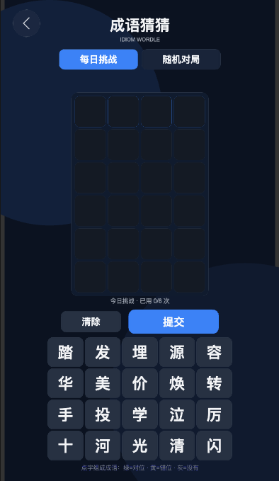
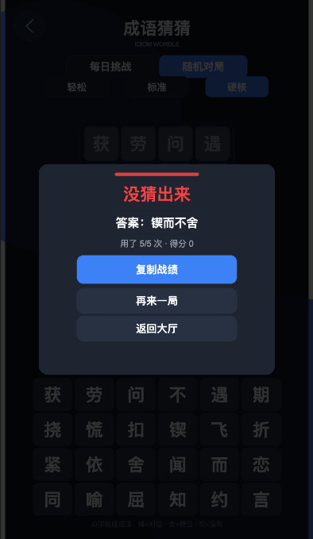

# 成语猜猜（Wordle 风格）设计

- 日期：2026-11-08
- 状态：**已实现（v1 验收通过）**
- 场景：`assets/games/game_wordle/scenes/Wordle.scene`（场景名 `Wordle`）
- 玩法定位：文字猜测 · 每日挑战 · 分享传播
- 前置文档：[`../plans/2026-11-05-game-catalog-and-roadmap.md`](../plans/2026-11-05-game-catalog-and-roadmap.md)



---

## 1. 一句话玩法

六次机会猜出一条四字成语，每次提交后每个字给出「位置正确 / 字在但位置不对 / 字不在」三态反馈。

> 与《成语填字》的区别：填字是**纵横交叉布局**的解谜，本作是**逐行猜测**的推理，词汇复用同一份词库，但不共享任何玩法代码。

---

## 2. 为什么不是自由输入

微信小游戏内没有可用的系统输入法（`EditBox` 在真机上依赖 `wx` 原生输入，输入法弹层会盖住棋盘且延迟不可控），而拼音输入需要自带输入法引擎，成本远超本作体量。

**采用「候选字池」方案**：

- 每局给一个 16–24 个字的中文候选池，其中**必含答案的 4 个字**（重复字按出现次数给出重复的格子），其余为从词库其它成语里抽的干扰字；
- 玩家点字填格，凑满 4 个字后提交；
- 反馈规则与 Wordle 完全一致。

这样做保留了「逐次排除 + 位置推理」的核心乐趣，又完全适配触屏。代价是不能自由输入、猜错字会直接暴露（干扰字被排除也是一条信息），因此难度靠**候选池大小**与**猜测次数**调节。

---

## 3. 规则

### 3.1 判定

对一次提交的 4 个字从左到右：

1. **绿（正确）**：与答案同位置同字；
2. **黄（错位）**：该字在答案中还有剩余未匹配的副本；
3. **灰（不在）**：其余。

重复字按「先绿后黄、每个答案副本只能用一次」计算（与 Wordle 一致），避免 `一心一意` 这类重复字成语给出错误反馈。

### 3.2 胜负

- 4 个字全绿 → 胜利；
- 用完次数仍未猜中 → 失败，公布答案。

### 3.3 难度

| 难度 | 候选池字数 | 可猜次数 | 干扰字强度 |
|------|-----------|---------|-----------|
| 轻松 | 16 | 6 | 随机取词库常用字 |
| 标准 | 20 | 6 | 一半取同义/同场景词 |
| 硬核 | 24 | 5 | 优先取同一条成语的字（更易混淆） |

「干扰字强度」在 v1 落为：**硬核档优先从答案所在成语的「同类词」（同一分组）里取字**，其余随机。

### 3.4 模式

- **每日挑战**：答案由日期字符串哈希决定，所有玩家当天同一题；固定标准难度；每天只能挑战一次（完成后显示结果，可看回放棋盘）。
- **随机对局**：可自选难度，随时重开。

### 3.5 计分

```
得分 = 100 × 剩余次数 × 难度系数（轻松 1.0 / 标准 1.2 / 硬核 1.5）
```

失败得 0 分。最高分按难度分别存档。

### 3.6 连续天数（每日模式）

每日挑战成功，则「连续天数」+1；断一天则清零。存 `tiny_games_wordle_streak`。

### 3.7 分享战绩

结算面板提供「复制战绩」，生成：

```
成语猜猜 · 每日 2026-11-08
🟨⬜🟩⬜
⬜🟩⬜🟩
🟩🟩🟩🟩
用了 3/6 次
```

微信内走 `wx.setClipboardData`，浏览器走 `navigator.clipboard`，失败回落到 Toast 提示。

---

## 4. 界面

坐标按 720×1280 设计基准，全部运行时 `Graphics` + `Label` 绘制，沿用 `common/ui/UITheme` 令牌与 `SceneSkin` 回填工具。

| 区块 | 内容 | 规格 |
|------|------|------|
| 顶栏 | 返回键（圆盘 `‹`）、标题「成语猜猜」、模式标签 | 高 120，底色 `SURFACE 240` + 1px 分隔线 |
| 难度条 | 轻松 / 标准 / 硬核（每日模式下置灰隐藏） | 胶囊按钮 132×48 |
| 棋盘 | 6 行 × 4 格 | 单格 92×92，间距 8；活动行描边 `PRIMARY` |
| 状态行 | 剩余次数、连击天数、清除 / 提交 | 提交 220×64 primary，清除 160×56 secondary |
| 候选池 | 6 列 × 4 行（按需行数） | 单格 96×88，已用格降透明度 |
| 结算卡 | 结果标题、答案、用时/次数、最高分、连续天数、复制战绩 / 再来一局 / 返回大厅 | 遮罩 + `PANEL_BG` 卡、`PRIMARY` 或 `SUCCESS`/`DANGER` 强调条 |

反馈色：绿 `COLOR.SUCCESS`、黄 `COLOR.WARNING`、灰 `COLOR.PANEL_BORDER`（字色 `TEXT_SECONDARY`）。

---

## 5. 数据与代码结构

```text
assets/games/game_wordle/
├── scenes/Wordle.scene          # Canvas + Grid root（挂 WordleGame）
└── scripts/
    ├── WordleCore.ts            # 纯逻辑，无 cc 依赖（Node 自检）
    └── WordleGame.ts            # 运行时 UI 组件
tools/verify-wordle-core.js      # 纯逻辑自检
```

- 词库**直接复用** `assets/games/game_idiom/scripts/IdiomData.ts` 的 509 条成语（只读导入，不复制）；
- 分组信息若词库没有，v1 用「共用字数量」近似「同类词」：取与答案共享至少 2 个字、长度相同、且不重复的成语作为同类池。

### 5.1 WordleCore 对外接口

```ts
export type CellMark = 'green' | 'yellow' | 'gray';
export type WordleDifficulty = 'easy' | 'medium' | 'hard';

export interface WordleDiffDef { id: WordleDifficulty; name: string; poolSize: number; maxGuesses: number; weight: number; }

export function evaluateGuess(answer: string, guess: string): CellMark[];
export function buildPool(answer: string, seed: number, poolSize: number, dict: readonly string[]): string[];
export function pickAnswer(seed: number, dict: readonly string[]): string;
export function dailySeed(dateKey: string): number;
export function scoreFor(diff: WordleDifficulty, usedGuesses: number, won: boolean): number;
export function shareGrid(rows: CellMark[][]): string;
```

所有随机都走 `mulberry32(seed)`，同种子结果完全可复现（与五子棋 / 数独的做法一致）。

---

## 6. 存档

| 键 | 内容 |
|----|------|
| `tiny_games_wordle_best_<diff>` | 各难度最高分 |
| `tiny_games_wordle_streak` | `{ days: number, lastDate: string }` |
| `tiny_games_wordle_daily` | `{ date, answer, pool, guesses, marks, done }` 供当日回看 |
| `tiny_games_wordle_save` | 随机局断点（答案、池、已提交行） |

坏档一律回落为「新开一局」，不抛异常。

---

## 7. 验收用例

1. 每日模式：同一天重进答案一致；次日换题；
2. 重复字成语（如 `一心一意`）判定符合「先绿后黄」；
3. 提交不足 4 字不生效并给出 Toast；
4. 6 次用尽 → 失败结算，公布答案；
5. 猜中 → 胜利结算，剩余次数与得分一致；
6. 清除按钮只清当前行，不动已提交行；
7. 复制战绩文本与棋盘一致（回到家粘贴核对）；
8. 返回大厅 → 再进入：随机局断点恢复、每日局保持已完成状态；
9. 候选池一定包含答案的全部字（含重复字）；
10. `node tools/verify-wordle-core.js` 全绿、`tsc --noEmit` 通过、预览 console 0 error。

---

## 8. 明确不做（v1）

- 自由输入 / 拼音输入法 / 自定义词库；
- 排行榜、好友对战、后端；
- 音效与震动；
- 皮肤与主题切换。

---

## 9. 实测记录（2026-11-08，浏览器验收）

环境：编辑器预览 `http://127.0.0.1:7456/`，设备档 iPhone 14 Pro（393×679 画布），
`node tools/verify-wordle-core.js` 29/29 通过，`tsc --noEmit` 通过，全程 console 0 error。

| # | 用例 | 结果 |
|---|------|------|
| 1 | 每日模式：同一天重进答案一致（清存档后仍是「容光焕发」） | ✅ |
| 2 | 重复字判定「先绿后黄」由自检覆盖（`一心一意` 系列 4 项） | ✅ |
| 3 | 不足 4 字点「提交」→ Toast「先点满 4 个字」，不产生行 | ✅ |
| 4 | 硬核 5 次用尽 → 失败结算，公布答案 | ✅ |
| 5 | 猜中 → 胜利结算，`已用 2/6 次` 与得分一致 | ✅ |
| 6 | 点已填格子 = 撤回一格；「清除」只清当前行 | ✅ |
| 7 | 复制战绩文本与棋盘一致（`navigator.clipboard` 读回核对） | ✅ |
| 8 | 返回大厅 → 从大厅图标再进：随机局 2 行进度原样恢复；每日局保持已完成并自动补弹结算卡 | ✅ |
| 9 | 难度切换：硬核 = 24 字池 / 5 行棋盘 / 6 列 4 行候选池 | ✅ |

### 9.1 验收中发现并修掉的问题

1. **操作按钮重叠**：`清除(180) / 换一局(330) / 提交(470)` 三者的实际 x 区间互相压盖（提交 240 宽盖住换一局右半边）。
   改为 `_layoutActions()` 按「当前可见按钮」的宽度总和 + 20 间距**整体居中**，日更模式只有两颗、结算后只剩一颗也不会出现空洞。
2. **难度条压住棋盘**：难度条底边 243 与棋盘顶边 240 重叠 3px。棋盘改为 **按 6 行高度做垂直居中**（`BOARD_CENTER_Y`），
   难度条上移到 206；硬核 5 行时棋盘上下留白自然对称。
3. **结算卡底部偏空**：卡片 620 高但内容只占 470，视觉重心偏上。卡片收到 500 高、强调条内缩 24px、按钮组重排。
4. **残局回来看不到答案**：只恢复到满行棋盘、结算卡不弹，答案就再也拿不到了。新增 `_resumeIfFinished()`，
   在 `_restoreOrStart()` 与「切回每日模式」两处补排期弹卡。
5. **误触重开**：点当前模式 / 当前难度原本会重开一局、清掉进度。改为纯空操作，重开只走「换一局」。

### 9.2 已知边界

- 结算卡没有独立关闭按钮，退出靠「再来一局 / 返回大厅」。
- 每日挑战完成后切到随机再切回每日，会再次弹出当日结算卡（可视为「回看棋盘」）。


